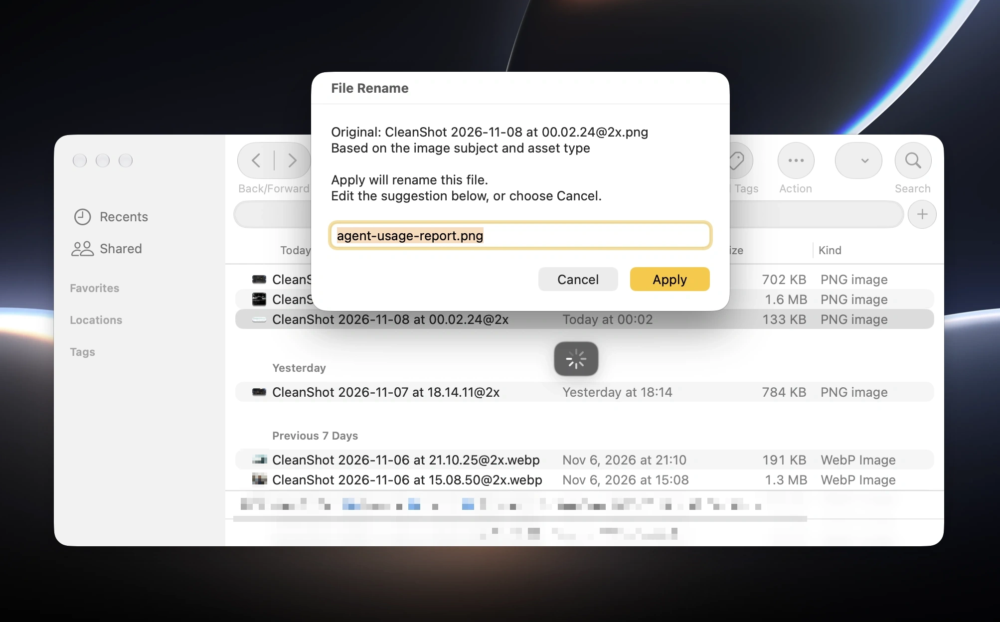

# File Rename for PopClip

[繁體中文](README.zh-TW.md)

Rename files with PopClip by translating their current names or looking at what's in a photo or video. You can start with names in Chinese, Japanese or other languages; this version suggests English names.

Highlight a few words → click an icon → see the suggestion → Apply. You can edit the suggested name before applying it.

| Icon | What it does | Example |
| --- | --- | --- |
| Language — Translate Filename | Translates the filename or words you select. | `週末野餐照片.jpg` → `weekend-picnic-photo.jpg` |
| Scan — Name from Content | Suggests a name based on a picture or video. | `picnic-photo.jpg` or `cooking-tutorial.mp4` |

The scan icon is available only in Finder. The extension interface is in English, with guides in English and Traditional Chinese.

Suggested names use 2–4 words and aim for no more than 32 characters, keeping the main subject and asset type, such as `command-key-icon.webp`. Unnecessary color, line-style and background details are left out. Translation keeps the source meaning; it does not guess what is inside the file. You can still edit the suggestion and add more words before applying it.

## Before you start

You need:

- A Mac with [PopClip](https://www.popclip.app/) 2026.8.1 or later.
- Your own Gemini API Key — a key from Google that lets this extension use its AI. Get one from [Google AI Studio](https://aistudio.google.com/app/api-keys).
- Python 3.9 or later, a small tool needed to rename files in Finder.
- ffmpeg if you want to name videos. You do not need it for pictures or text.

The extension does not install these tools for you. For help, see [setup instructions](CONTRIBUTING.md#setup-tools). If you only translate highlighted words in another app and enter your key in the extension settings, you do not need either tool.

## Install

[Download FileRename.popclipextz](https://github.com/chasehuang/file-rename/releases/latest/download/FileRename.popclipextz) · [Release notes](https://github.com/chasehuang/file-rename/releases/latest)

1. Double-click `FileRename.popclipextz`.
2. Confirm PopClip's prompt to install the unsigned extension.
3. Open File Rename in PopClip's extension settings and enter your Gemini API Key.

PopClip saves the key in your Mac's Keychain. If you prefer a local `.env` file, you must choose its path in the settings; no file is used automatically. Leaving both fields blank asks you to set up a key. See [local settings](CONTRIBUTING.md#local-credentials) for this optional method.

If you downloaded the source code instead, see [how to make the install file](CONTRIBUTING.md#tests-and-build).

## Rename a file in Finder

1. Select one file and press Return to edit its name.
2. Use the mouse to highlight any part of the name. You can leave out the file extension, such as `.jpg`.
3. Click the language icon to translate the name, or the scan icon to name a picture or video from its content.
4. Read the suggested name, edit it if you like, and click Apply. Click Cancel to leave the name unchanged.

For example, highlight just `野餐` in `週末野餐照片.jpg`. The extension still translates the whole name and can suggest `weekend-picnic-photo.jpg`. Japanese names work too: `週末のピクニック.jpg` can become `weekend-picnic.jpg`.

Pressing Return alone does not bring up PopClip; use the mouse to highlight some text. The first time you use it, macOS may ask to let PopClip control Finder.

The file stays in the same folder and keeps endings such as `.jpg` or `.mp4`. If a name is already taken, the extension adds a number such as `-2` or asks you to try again; it does not overwrite another file. If you select a different file or the file changes while the suggestion is open, the extension stops.

## Use words from another app

Highlight a title, phrase or filename and click the language icon. After you approve the suggestion, it replaces the selected text where typing is allowed. Otherwise, it is copied so you can paste it yourself.

## What you can use

| What you select | What works |
| --- | --- |
| A file in Finder | Translate its name. |
| PNG, JPG/JPEG or WebP | Name it from the picture. Each original file can be up to about 14.7 MB. |
| MP4, MOV, M4V, WebM or MKV | Name it from up to eight pictures taken from the video. Requires ffmpeg. |
| A document or audio file | Translate its name; the contents are not read. |

The extension handles one file at a time; it cannot rename a batch or a folder. Select the original file rather than a shortcut that points somewhere else. Animated pictures use only their first frame. Suggested names use lowercase English letters, numbers and `-`. The 32-character target excludes endings such as `.jpg`; longer names are allowed when needed, up to 64 characters. Selected text can be up to 2,000 characters.

## What is sent to Google

Gemini needs an internet connection to create the names. Reading the file, preparing pictures, taking pictures from a video and renaming the file happen on your Mac. Clicking an icon sends the material to Google before the suggested name appears. Cancel stops the rename; it cannot take back what has already been sent.

- Translate filename: sends the file's current name or the words you highlighted to Gemini, which turns them into an English filename.
- Name a picture: removes recorded details such as where and when the picture was taken, then lets Gemini look at it and suggest an English filename. Your original picture is unchanged.
- Name a video: takes up to eight pictures from the video for Gemini to name it. The full video and its sound are not uploaded.

The extension makes a separate picture on your Mac for uploading and deletes that local copy when preparation is done. If it cannot remove the extra recorded details, it stops the upload. Faces, addresses and words visible in the picture are still sent; they are not automatically covered up.

Using Gemini 3.1 Flash-Lite counts toward your Google account's allowance and may cost money. For costs and how Google uses data, see its [pricing](https://ai.google.dev/gemini-api/docs/pricing) and [service terms](https://ai.google.dev/gemini-api/terms).

## If something does not work

| Problem | What to try |
| --- | --- |
| PopClip does not appear after Return | Use the mouse to highlight a few words in the filename. |
| The key cannot be found | Paste your own Gemini API Key into the extension settings. |
| The Finder file cannot be found | Select just one file and allow PopClip to control Finder. |
| Python or the video tools are missing | Follow the [tool setup instructions](CONTRIBUTING.md#setup-tools). |
| A picture is too large or cannot be processed | Save a smaller PNG or JPG copy, or use the translation icon. |
| The file changed or the name is taken | Close the preview, select the file again and try once more. |
| No name is suggested | Check your internet connection, Gemini key and Google usage allowance. |

## More information

Tool setup, development and local settings are covered in [CONTRIBUTING.md](CONTRIBUTING.md), along with the [validation status](CONTRIBUTING.md#validation-status). Changes are listed in [CHANGELOG.md](CHANGELOG.md).

The extension code is available under the [MIT License](LICENSE). This is an independent extension, not an official PopClip or Google product.

Icons are from [Lucide](https://lucide.dev/) and used under the ISC license, with the stroke width adjusted. See the [full icon license](source/FileRename.popclipext/icons/LICENSE).

## How much does filename translation cost?

For the five examples below, the average was about US$0.000162 per translation: around US$0.16 for 1,000 filenames, or roughly 6,000 translations for US$1.

A token is a small unit of text that Google uses to measure AI usage; it is not the same as a character or a word. The input count includes the extension's full naming instructions as well as your filename. These five requests used 580–602 tokens each in total.

Measured on 2026-11-06 using Gemini 3.1 Flash-Lite and the naming instructions from before the short-name update. We translated five made-up filenames, once each, without reading or uploading their file contents. Costs use Google's standard paid prices: US$0.25 per million input tokens and US$1.50 per million output tokens. [Google's pricing](https://ai.google.dev/gemini-api/docs/pricing#gemini-3.1-flash-lite).

| Original filename | Input tokens | Output tokens | Estimated cost each | Translations for US$1 at this rate |
| --- | ---: | ---: | ---: | ---: |
| `週末野餐照片.jpg` | 571 | 10 | US$0.00015775 | 6,339 |
| `週末のピクニック.jpg` | 572 | 8 | US$0.00015500 | 6,451 |
| `東京旅行住宿清單.xlsx` | 572 | 12 | US$0.00016100 | 6,211 |
| `家族で作る簡単な晩ごはんレシピ.docx` | 574 | 11 | US$0.00016000 | 6,250 |
| `2026年冬季家庭旅遊行程與交通預算整理.pdf` | 581 | 21 | US$0.00017675 | 5,657 |

The last column is rounded down. Output also includes any tokens used by the AI to work out its answer; none of those extra tokens were reported in these five requests. The estimates do not subtract a free allowance or a discount for reused input, and exclude taxes.

These are sample results for translating filenames, not a fixed price for every request. Longer text, different answers and changes to the naming instructions can change the cost. Naming pictures or videos uses additional image input, so this table does not estimate those actions. Prices may change; the table uses the rates checked on the date above.
